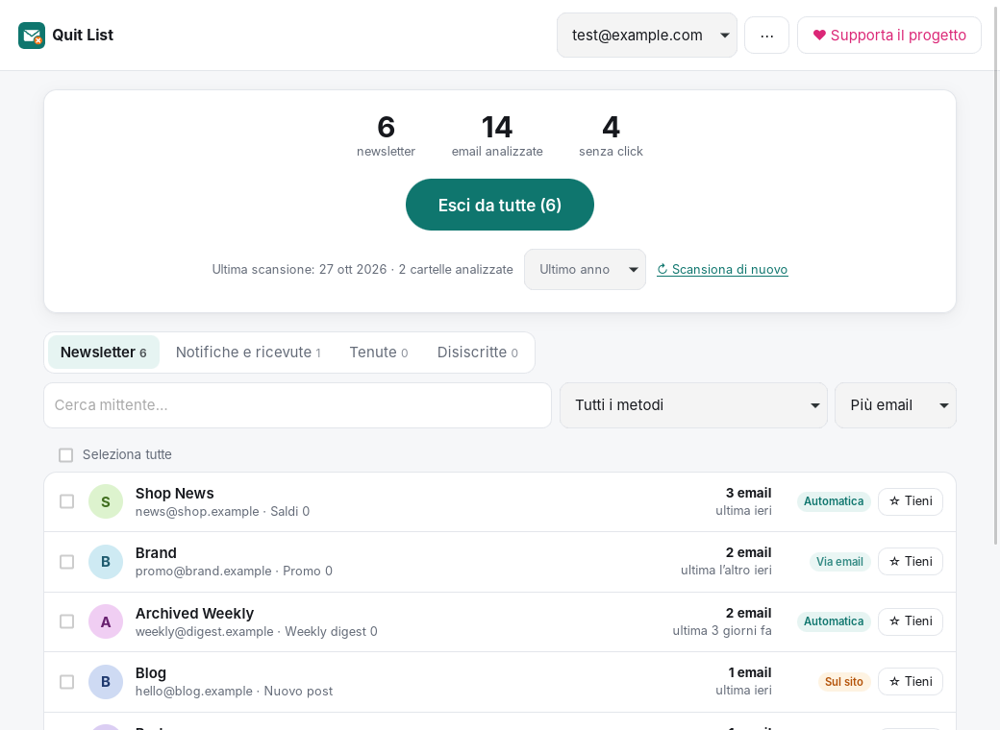
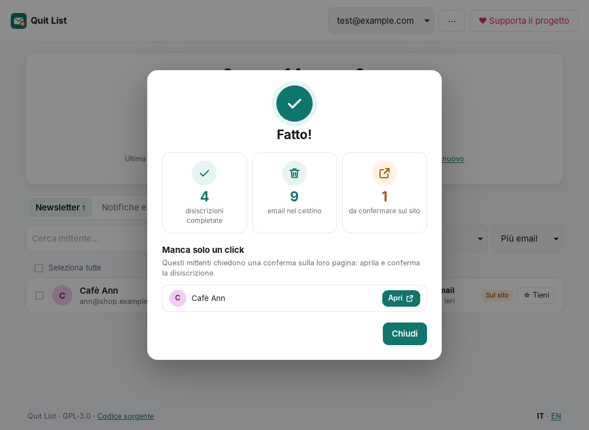

# Quit List

**Esci da tutte le mailing list. In un click.**
*Quit every mailing list. In one click.* — [English below](#english)

Quit List è un'app desktop gratuita e open source che trova nella tua casella tutte le newsletter e le mailing list e ti disiscrive da tutte insieme. Niente abbonamenti, niente versione "Pro", niente pubblicità: il progetto vive solo di donazioni.



## Come funziona

1. **Connetti la tua email** (Gmail, Outlook, Yahoo, iCloud, Libero, Virgilio, Proton Mail Bridge, Fastmail, GMX… o qualsiasi server IMAP).
2. **Scansiona**: l'app legge solo le *intestazioni* delle email (mittente, oggetto, `List-Unsubscribe`), mai il contenuto, e raggruppa i messaggi per mittente.
3. **Premi "Esci da tutte"**. Per ogni mailing list Quit List usa il metodo migliore disponibile:

| Metodo | Come | Serve fare qualcosa? |
| --- | --- | --- |
| **Automatica** | Richiesta *one-click* [RFC 8058](https://www.rfc-editor.org/rfc/rfc8058) (`List-Unsubscribe-Post`) | No |
| **Via email** | Invia l'email di disiscrizione (`mailto:` di `List-Unsubscribe`) dal tuo account | No |
| **Sul sito** | Il mittente offre solo una pagina web | Un click: l'app ti dà la lista dei link da aprire |

Se la richiesta automatica fallisce, l'app ripiega da sola sull'email e poi sul link.

Altre funzioni:

- **Tieni** i mittenti che vuoi continuare a ricevere: "Esci da tutte" li salta.
- **Sposta nel cestino** (opzionale) tutte le email già ricevute dalle liste che lasci.
- **Controllo "continua a scrivere"**: alla scansione successiva vedi chi ha ignorato la disiscrizione e puoi riprovare.
- Più account, interfaccia in italiano e inglese, tema chiaro/scuro.



## Privacy

- **Tutto in locale.** Nessun server di Quit List, nessuna telemetria, nessun account da creare.
- La password è salvata nel **portachiavi del sistema** (Keychain su macOS, Credential Manager su Windows, Secret Service su Linux). Se il portachiavi non è disponibile resta solo in memoria fino alla chiusura.
- Le uniche connessioni in uscita sono verso il tuo provider email (IMAP/SMTP) e verso gli indirizzi di disiscrizione indicati dai mittenti stessi.
- La scansione apre la posta in sola lettura (`EXAMINE` + `BODY.PEEK`): nessuna email viene segnata come letta.

## Accesso: password per le app

Quit List si collega via IMAP/SMTP. Molti provider non accettano la password normale e richiedono una **password per le app**: l'app lo rileva dall'indirizzo e ti porta alla pagina giusta.

| Provider | Cosa serve |
| --- | --- |
| Gmail | [Password per le app](https://myaccount.google.com/apppasswords) (richiede la verifica in due passaggi) |
| Yahoo, iCloud, Fastmail, Zoho, Yandex | Password per le app |
| Libero, Virgilio, TIM/Alice, Tiscali, GMX, Posteo, mailbox.org | Password normale (IMAP attivo) |
| Proton Mail | [Proton Mail Bridge](https://proton.me/mail/bridge) avviato, con le credenziali del Bridge |
| Outlook / Hotmail personali | Microsoft sta eliminando le password per le app: serve OAuth, non ancora supportato (vedi roadmap) |

Perché non "Accedi con Google"? L'accesso OAuth alla posta Gmail richiede una verifica di sicurezza annuale a pagamento per ogni app pubblicata: è proprio il costo che spinge app simili verso gli abbonamenti. Le password per le app permettono di restare gratuiti.

## Installazione

Scarica l'installer per il tuo sistema dalla pagina [Releases](https://github.com/rickardomc/quit-list/releases) (macOS, Windows, Linux).

### Compilare dal sorgente

Requisiti: [Node.js](https://nodejs.org) 20+, [Rust](https://rustup.rs) stabile e le [dipendenze di sistema di Tauri](https://v2.tauri.app/start/prerequisites/) (su Linux anche `libdbus-1-dev` e `libssl-dev`).

```bash
npm install
```

```bash
npm run tauri dev
```

Per creare l'installer:

```bash
npm run tauri build
```

Test del backend:

```bash
cargo test --manifest-path src-tauri/Cargo.toml
```

## Struttura

```
src/                 interfaccia (TypeScript + Vite, nessun framework)
  main.ts            viste e azioni
  i18n.ts            testi italiano/inglese
  config.ts          link a sorgente e donazioni
src-tauri/src/       backend (Rust)
  providers.rs       server IMAP/SMTP noti per dominio
  scan.rs            scansione della casella e spostamento nel cestino
  listunsub.rs       parsing di List-Unsubscribe / List-Unsubscribe-Post / mailto
  unsub.rs           esecuzione delle disiscrizioni (one-click, email, link)
  mail.rs            connessioni IMAP e SMTP
  store.rs           dati locali (JSON) e portachiavi
```

Per pubblicare una release: crea un tag `vX.Y.Z` e fai push; il workflow `release.yml` compila gli installer e crea una release in bozza.

## Roadmap

- Accesso OAuth per Outlook/Microsoft 365 (PKCE, nessun segreto da distribuire)
- Scansione di altre cartelle (es. "Tutti i messaggi" di Gmail, Spam)
- Rilevamento dei link di disiscrizione nel corpo delle email che non hanno `List-Unsubscribe`

Contributi benvenuti: apri una issue o una pull request.

## Supporta il progetto

Quit List è e resterà gratuito. Se ti ha fatto risparmiare tempo puoi supportarlo con una donazione: [GitHub Sponsors](https://github.com/sponsors/rickardomc). Le donazioni coprono la firma del codice per macOS/Windows e il tempo di sviluppo.

## Licenza

[GPL-3.0-or-later](LICENSE). Puoi usare, studiare, modificare e redistribuire l'app; le versioni modificate distribuite devono restare open source con la stessa licenza.

Ispirato da [Paperweight](https://github.com/wslyvh/paperweight) di wslyvh. Quit List è una riscrittura indipendente con Tauri focalizzata sulla disiscrizione; non contiene codice di Paperweight.

---

## English

Quit List is a free, open source desktop app that finds every newsletter and mailing list in your inbox and unsubscribes you from all of them at once. No subscriptions, no "Pro" tier, no ads: the project is funded by donations only.

- **Connect** any IMAP account (Gmail and others via app passwords, Proton Mail via Bridge).
- **Scan**: only headers are read (`From`, `Subject`, `List-Unsubscribe`), never message bodies, and the mailbox is opened read-only.
- **Quit all**: RFC 8058 one-click when available, otherwise the `mailto:` unsubscribe email sent from your own account, otherwise a list of links for you to open. Failed one-click requests fall back automatically.
- **Keep** the senders you like, optionally **move** past emails to the trash, and see who **keeps sending** after you unsubscribed.
- **Local-first**: no Quit List servers, no telemetry; passwords live in the OS keychain.

Build with `npm install` and `npm run tauri dev` (see the requirements above). Licensed under GPL-3.0-or-later. Donations: [GitHub Sponsors](https://github.com/sponsors/rickardomc).
